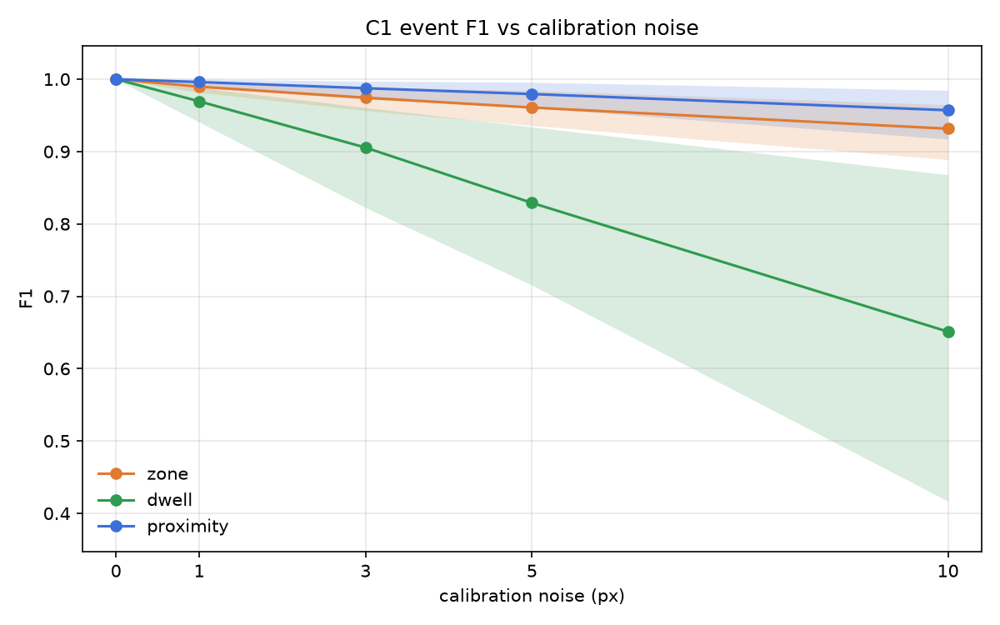
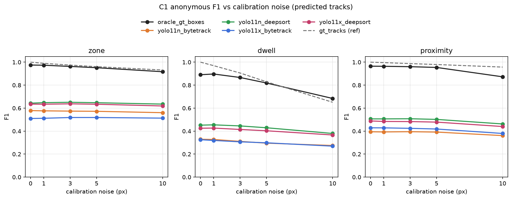

# Calibration-Aware Safety Events

**How much does a sloppy camera calibration change the safety alarms, and how does that compare with detection and tracking errors?**

Camera-based safety rules are written in meters ("stay 1.5 m apart", "don't enter this area"), but a camera only sees pixels. A planar homography *H*, estimated from four hand-picked image-to-floor correspondences, converts foot pixels to ground-plane positions. Deployed systems treat *H* as exact. This project measures how calibration error propagates to **event-level** precision, recall, and F1 for three event types (zone entry, dwell, proximity), and compares it with the errors introduced by off-the-shelf detectors and trackers.

Course project for PRCV (CS 5330), Northeastern University.
Dhanya Kini Bailoor and Tejaswini Sarikonda.

---

## Status

The full pipeline is built and verified on WILDTRACK camera **C1**:

```
video → detection → tracking → foot point → homography → event logic → scoring
```

Completed experiments:

1. Calibration sweep on ground-truth tracks (5 noise levels × 200 trials).
2. Detection (YOLO11n, YOLO11x) and tracking (ByteTrack, DeepSORT), scored on the ground plane.
3. A perception error budget: foot points, detector vs tracker, and boundary effects.
4. Event F1 on predicted tracks under perfect calibration.
5. Calibration sweep on predicted tracks (5 models × 5 noise levels × 100 trials).

## Main findings

1. **Perception error dominates calibration error.** With perfect calibration, the best tracker (YOLO11x + DeepSORT) reaches zone / dwell / proximity F1 of only 0.54 / 0.37 / 0.36. With perfect tracks and 10 px of calibration noise, the same events still score 0.93 / 0.65 / 0.96.
2. **Missed events, not false alarms, are the problem.** When a zone alarm fires it is almost always real (anonymous precision 0.93–0.96), but recall is only 0.35–0.49. Detectors and trackers find fewer than half the people per frame in this crowded, 2 fps setting.
3. **Calibration and perception errors overlap rather than stack up.** With real trackers, 10 px of calibration noise costs zone alarms almost nothing (97–100% of F1 kept) and dwell about 15%.
4. **Proximity is the most robust event and dwell the most fragile,** with perfect tracks and with real ones. Homography error is spatially smooth, so two nearby people are shifted almost identically. Dwell stacks a space and a time threshold, and most visits last only 2–3 s.
5. **Distance from the camera dominates position error,** more than extrapolating outside the calibration rectangle (at 10 px: 0.22 m near, 0.63 m far).

## Results

### 1. Calibration error on ground-truth tracks

| ε (px) | Zone F1 | Dwell F1 | Proximity F1 | Mean position error |
|---:|---:|---:|---:|---:|
| 0 | 1.000 | 1.000 | 1.000 | 0.000 m |
| 1 | 0.990 (0.982–0.996) | 0.969 (0.941–0.988) | 0.996 (0.989–1.000) | 0.042 m |
| 3 | 0.974 (0.957–0.989) | 0.905 (0.823–0.961) | 0.988 (0.972–0.997) | 0.127 m |
| 5 | 0.961 (0.936–0.984) | 0.829 (0.715–0.934) | 0.979 (0.961–0.996) | 0.212 m |
| 10 | 0.932 (0.889–0.965) | 0.651 (0.417–0.868) | 0.957 (0.917–0.985) | 0.427 m |

Mean over 200 trials; brackets show the 5th–95th percentile.



**Calibration-tolerance guideline (F1 ≥ 0.95, perfect tracks)**

| Event | On average | Worst 5% of trials |
|---|---|---|
| Proximity | ≥ 10 px | 5 px |
| Zone | 5 px | 3 px |
| Dwell | 1 px | < 1 px |

This is the target for when perception is good; with today's detectors and trackers, calibration within about 5 px costs almost nothing extra (section 4).

### 2. Detection and tracking (ground-plane scoring, 1 m boundary margin)

| Model | Precision | Recall | ID switches | MOTA |
|---|---:|---:|---:|---:|
| YOLO11n + ByteTrack | 0.775 | 0.410 | 442 | 0.229 |
| YOLO11n + DeepSORT | 0.749 | 0.452 | 329 | 0.254 |
| YOLO11x + ByteTrack | 0.719 | 0.412 | 472 | 0.186 |
| YOLO11x + DeepSORT | 0.700 | 0.446 | 296 | 0.214 |

The larger detector does not help on the ground plane: its extra detections are mostly partly hidden people, whose box bottoms give poor foot points. DeepSORT has the fewest ID switches.

**Perception error budget**

| Stage | Finding |
|---|---|
| Foot point with perfect boxes (oracle) | 98.6% recall within 0.5 m: the bottom-center convention itself works |
| Foot-point bias with detector boxes | 0.13–0.17 m toward the camera (median) |
| Detector alone (YOLO11x, conf 0.1) | 57.8% recall |
| Tracker | loses a further 9–16 points of recall by design (it filters low-confidence boxes); loosening settings does not recover it without adding false positives |
| Missed people | about half had a detected box with a wrong foot point (mostly at 10–20 m) |
| Apparent false positives | 85% are real, unannotated people just outside the annotated area (left edge) |

### 3. Event F1 on predicted tracks (perfect calibration)

| Model | Zone F1 | Dwell F1 | Proximity F1 | Anonymous zone F1 (P / R) |
|---|---:|---:|---:|---|
| Oracle (GT boxes) | 0.975 | 0.874 | 0.965 | 0.975 (0.986 / 0.964) |
| YOLO11n + ByteTrack | 0.415 | 0.244 | 0.252 | 0.579 (0.958 / 0.414) |
| YOLO11n + DeepSORT | 0.531 | 0.350 | 0.366 | 0.643 (0.932 / 0.491) |
| YOLO11x + ByteTrack | 0.353 | 0.229 | 0.266 | 0.510 (0.929 / 0.351) |
| YOLO11x + DeepSORT | 0.540 | 0.368 | 0.360 | 0.635 (0.930 / 0.482) |

*Identity* scoring requires the alarm to name the right person; *anonymous* scoring only requires the right zone (or place) and time. The gap between them (about 0.1–0.14 F1) is the cost of ID switches; the rest is events never seen. Zone alarms fire about 0.5 s late (median); proximity alarms 1–3 s late, since both people must be tracked at once.

### 4. Calibration error on predicted tracks

Relative F1 at 10 px = F1(10 px) / F1(0 px). Zone and dwell use anonymous scoring; proximity uses identity scoring (see the note below).

| Model | Zone | Dwell | Proximity |
|---|---:|---:|---:|
| Perfect tracks (section 1) | 0.93 | 0.65 | 0.96 |
| Oracle (GT boxes) | 0.94 | 0.77 | 0.97 |
| YOLO11n + DeepSORT | 0.99 | 0.84 | 0.97 |
| YOLO11x + DeepSORT | 0.97 | 0.86 | 0.97 |
| YOLO11n + ByteTrack | 0.97 | 0.84 | 1.01 |
| YOLO11x + ByteTrack | 1.01 | 0.83 | 0.97 |

Values slightly above 1 are trial-to-trial noise. Anonymous proximity scoring drops more (0.89–0.92) because it requires the pair's midpoint within 1 m of the true one; widening that gate to 2 m restores the oracle to 0.98. So proximity alarms still fire under calibration error, but the reported location can be off by about 1 m.


---

## Dataset

[WILDTRACK](https://www.epfl.ch/labs/cvlab/data/data-wildtrack/) (Chavdarova et al., CVPR 2018): 7 synchronized, calibrated cameras, 1920 × 1080, 400 annotated frames at 2 fps (about 200 s), 313 people. Ground positions lie on a 480 × 1440 grid with 2.5 cm cells and origin (−3.0 m, −9.0 m). We use **one camera at a time**; the calibration provides the true homography *H\**.

### Download

Only the frames-and-annotations zip is needed (about 6.3 GB).

```bash
mkdir -p data && cd data
curl -L -C - -o Wildtrack_dataset_full.zip \
  "http://documents.epfl.ch/groups/c/cv/cvlab-unit/www/data/Wildtrack/Wildtrack_dataset_full.zip"
# If the download stops, run the same command again; -C - resumes it.
ditto -x -k Wildtrack_dataset_full.zip .   # macOS; the original zip can fail with other unzip tools
cd ..
```

The code expects the dataset at `data/Wildtrack_dataset` (set in one config variable, `DATA_ROOT`).

### Conventions (verified)

| Item | Convention |
|---|---|
| World coordinates | Meters everywhere in our code |
| Calibration `tvec` | Centimeters in the XML; divided by 100 on load |
| Intrinsics | `intrinsic_zero` (images are already undistorted) |
| Rotation | `rvec` converted with `cv2.Rodrigues` |
| Camera mapping | C1–C4 = CVLab1–4, C5–C7 = IDIAP1–3 (checked visually on all 7) |
| View index | `viewNum` is 0-based, so C1 = 0; a box of −1 means not visible |
| Time | Annotation file numbers step by 5; consecutive annotated frames are 0.5 s apart |
| Ground-truth boxes | Projected cylinders, not tight person boxes, so tracks are scored on the ground plane |

---

## Setup

```bash
python3 -m venv .venv
source .venv/bin/activate
pip install -r requirements.txt
```

Requires Python 3 with numpy, opencv-python, pandas, matplotlib, pyyaml, scipy, tqdm, and pytest. Detection and tracking also use `ultralytics` (YOLO, which installs PyTorch), `supervision` (ByteTrack), and `deep-sort-realtime` (DeepSORT). `setuptools<81` is pinned because `deep-sort-realtime` still imports `pkg_resources`. The heavy libraries are imported only inside the functions that use them, so the rest of the code and the tests run without them. On a Mac, pass `--device mps` to the detection script to use the GPU.

## Repository layout

```
configs/events.yaml   zones, thresholds, hysteresis, debounce, dwell time
src/
  data.py             annotation loading, position ID → meters
  geometry.py         calibration, H* = K [r1 r2 t], projection, normalized DLT
  events.py           shared hysteresis function; zone, dwell, proximity detection
  evaluation.py       event matching and precision / recall / F1
  perturb.py          calibration points, pixel perturbation, single trial
  tracking.py         frame list, detection/track CSV format, tracker wrappers, tracking scores
  viz.py              plots and overlays
scripts/              runnable checks and experiments (below)
tests/                pytest suite
data/                 dataset (gitignored)
results/              detection and track CSVs, id maps, tracking summary (committed, small)
outputs/              results and plots (gitignored)
docs/figures/         selected plots committed for this README
```

## Running the pipeline

Run from the repository root.

```bash
# 1. Checks: dataset, calibration, geometry on all 7 cameras
python scripts/inspect_dataset.py
python scripts/check_annotations.py
python scripts/check_calibration.py
python scripts/check_homography.py        # overlays → outputs/check_homography_C{1..7}.png

# 2. Zones and the answer key (ground-truth events)
python scripts/show_zones.py
python scripts/make_gt_events.py          # → outputs/gt_events_C1.csv (+ no-hysteresis version)
python scripts/check_scoring.py           # answer key vs itself: every F1 must be 1.0

# 3. End-to-end sanity check: 0 px noise must give F1 = 1.0 on every seed
python scripts/check_zero_noise.py

# 4. Calibration sweep on ground-truth tracks (5 noise levels × 200 trials)
python scripts/run_sweep.py               # → outputs/sweep_C1_gt_tracks.csv and plots

# 5. Detection and tracking
python scripts/run_detection.py --device mps   # → results/detections/det_C1_{yolo11n,yolo11x}.csv
python scripts/run_tracking.py                 # → results/tracks/tracks_C1_<detector>_<tracker>.csv (4 files)
python scripts/check_tracks.py                 # → results/tracks/tracking_summary_C1.csv, idmap_*.csv
                                               #   overlays → outputs/tracks/
python scripts/diagnose_foot_points.py         # perception error budget → outputs/tracks/

# 6. Events on predicted tracks, then the calibration sweep on them
python scripts/run_events_on_tracks.py    # → outputs/events_on_tracks_C1.csv
python scripts/run_sweep_tracks.py        # → outputs/sweep_C1_pred_tracks.csv and plots (checks eps = 0 against step 6)

# Tests (73)
python -m pytest
```

A quick detection test on a few frames: `python scripts/run_detection.py --limit 20 --device mps`. DeepSORT runs on the CPU on a Mac and takes about 9 minutes per detector.

## Method

**Events.** Each event becomes one number per frame, the *margin*: signed distance inside the zone (zone), or `threshold − distance` between two people (proximity). One shared state machine turns margins into intervals:

- on when the margin ≥ +h for `debounce_frames` consecutive frames
- off when the margin ≤ −h for `debounce_frames` consecutive frames
- a track may be missing for up to `max_gap_frames` without ending an open event

Dwell fires when a zone visit lasts at least `dwell_seconds`; the alarm starts at entry + `dwell_seconds`.

| Parameter | Value |
|---|---|
| Zones | 3 m × 3 m squares: Near (6.0, 0.0), Medium (7.0, 12.0), Far (4.0, 20.0), at 6.6, 18.0 and 26.3 m from the camera |
| Zone hysteresis | 0.1 m |
| Proximity threshold / hysteresis | 1.5 m / 0.1 m |
| Dwell time | 2.0 s (lowered from 3.0 s: 129 events instead of 32) |
| Debounce | 2 frames |
| Max gap | 1 frame |

**Answer key (C1).** 222 zone, 129 dwell, and 350 proximity events. Without hysteresis, the same perfect positions give 277, 133, and 562, so 25% of zone and 61% of proximity alarms would be flicker.

**Calibration perturbation.** The four calibration points form a 10.5 m × 24 m rectangle ("wide" layout); the Near zone lies outside it. For each trial, each of the four calibration pixels is moved by exactly ε ∈ {0, 1, 3, 5, 10} px in a uniformly random direction. *H* is re-estimated with our own normalized DLT (Hartley–Zisserman, verified against OpenCV), every foot pixel is re-projected, and events are re-detected and scored. Each level uses the same seeds.

**Event matching.** *Identity* scoring: events match when they share a type and identity (zone + person, or person pair) and overlap in time, one-to-one by temporal IoU. *Anonymous* scoring: zone and dwell events match by zone and time; proximity events by time and a pair midpoint within 1 m.

**Detection and tracking.** Two detectors (YOLO11n and YOLO11x, person class only, confidence ≥ 0.1, image size 1280) run on the 400 annotated C1 frames. Each detection file is tracked with ByteTrack (motion and box overlap; also uses low-score boxes) and DeepSORT (adds an appearance embedding; receives boxes with score ≥ 0.3 and confirms a track after 2 frames). Both keep a lost track for 2 s (4 frames at 2 fps).

**Track CSV format.** One row per tracked person per frame, boxes in original 1920 × 1080 pixels:

| Column | Meaning |
|---|---|
| `frame_idx` | 0–399, same as `load_annotations` |
| `frame_number` | annotation file number (steps of 5) |
| `time_sec` | `frame_idx / 2` |
| `track_id` | tracker's ID for the person (not a ground-truth `person_id`) |
| `xmin, ymin, xmax, ymax` | box corners in pixels |
| `score` | detector confidence of the matched box |

**Scoring tracks.** The foot point is the bottom-center of the box, `((xmin + xmax) / 2, ymax)`, projected with *H\**. Predictions are matched to ground-truth positions per frame (Hungarian, ≤ 0.5 m). Matching uses the full annotated area, but counts use an inner area shrunk by 1 m (`--boundary-margin`), because real but unannotated people stand just outside the area. Box IoU (≥ 0.5) is reported as a secondary score.

**Linking tracks to people.** `idmap_C1_<detector>_<tracker>.csv` maps each track to the person it matched most often, with its purity. Tracks that never match get a unique negative `person_id` (`-track_id`). `relabel_tracks` keeps the higher-score row when two tracks map to the same person in one frame. The id map stays fixed during the calibration sweep.

**Proximity on predicted tracks** is computed on the 1 m inner area for both predictions and ground truth (`outputs/gt_events_C1_proximity_inner.csv`, 310 events), so unannotated people near the edge do not create false pairs. Zone and dwell use the full answer key.

## Verification

| Check | Result |
|---|---|
| Annotations vs the paper | 400 frames, 313 people, 30.41 frames/person |
| *H\** for C1 | Camera height 2.889 m; round trip ≈ 1e-13 m |
| Geometry tests, all 7 cameras | Round trip < 1e-6 m; matches `cv2.projectPoints` within 0.01 px |
| Hysteresis jitter test | ±5 cm jitter: 0 events with hysteresis, 20 without |
| Scoring self-check | F1 = 1.0 on every row, including one-frame events |
| Own DLT, 0 px | Recovers *H\** to ≈ 1.7e-9 |
| Full pipeline, 0 px | F1 = 1.0 on all seeds; largest foot shift 2.5e-14 m |
| True positions through the track path | F1 = 1.0 |
| Predicted-track sweep at 0 px | Matches `events_on_tracks_C1.csv` exactly for all models and both scorings |

## Design choices to note

- **Duration** is `end − start`, so "dwell ≥ 2 s" means seen inside for at least 5 frames at 2 fps.
- **Matching is frame-inclusive:** an event covers `[start, end + 0.5 s)`, so one-frame events can match.
- **A missing frame resets a debounce run**, even within the allowed gap, so single missed detections can delay or remove alarms.
- **Entering a zone** requires being 10 cm inside its edge.
- **Re-projected positions are rounded to 6 decimals** (1 µm) before detection, because positions, zone edges and the 0.1 m band all fall on the 2.5 cm grid.
- **The proximity pre-filter** (2.1 m) uses the positions being evaluated, never the ground truth, so false alarms caused by a bad *H* stay visible.
- **Tracker inputs differ:** ByteTrack receives every box down to 0.1 confidence, DeepSORT only ≥ 0.3, so the tracker comparison includes that threshold difference. Loosened settings were tested only as a sensitivity check.

## Limitations

- Only camera C1 and one calibration layout.
- Short clip (200 s), so the Near zone (33 zone, 17 dwell events) is noisier.
- 2 fps limits timing resolution to 0.5 s and makes tracking harder than at video frame rates.
- Equal noise at all four points; minimal 4-point case only.
- Detectors are used off the shelf, without fine-tuning on WILDTRACK.

## Roadmap

- [x] Calibration sweep on ground-truth tracks
- [x] Detection (YOLO11n, YOLO11x) and tracking (ByteTrack, DeepSORT) on C1, scored on the ground plane
- [x] Perception error budget (foot points, detector vs tracker, boundary effects)
- [x] Event F1 on predicted tracks (identity and anonymous scoring)
- [x] Calibration sweep on predicted tracks
- [ ] Threshold-distance analysis and dwell-failure breakdown
- [ ] Add ε = 2 px for a finer guideline
- [ ] Foot point: box bottom-center vs pose-model ankles
- [ ] Camera bump (small rotations) and calibration-layout experiments
- [ ] More than 4 points as a mitigation
- [ ] 2–3 more cameras with different viewing angles

## References

1. R. Hartley and A. Zisserman. *Multiple View Geometry in Computer Vision*, 2nd ed. Cambridge University Press, 2003.
2. A. Criminisi, I. Reid, and A. Zisserman. A plane measuring device. *Image and Vision Computing*, 17(8):625–634, 1999.
3. N. S. Punn et al. Monitoring COVID-19 social distancing with person detection and tracking via fine-tuned YOLO v3 and Deepsort techniques. arXiv:2005.01385, 2020.
4. D. Yang et al. A vision-based social distancing and critical density detection system for COVID-19. *Sensors*, 21(13):4608, 2021.
5. T. Chavdarova et al. WILDTRACK: A multi-camera HD dataset for dense unscripted pedestrian detection. *CVPR*, 2018.
6. Y. Zhang et al. ByteTrack: Multi-object tracking by associating every detection box. *ECCV*, 2022.
7. N. Wojke, A. Bewley, and D. Paulus. Simple online and realtime tracking with a deep association metric. *ICIP*, 2017.