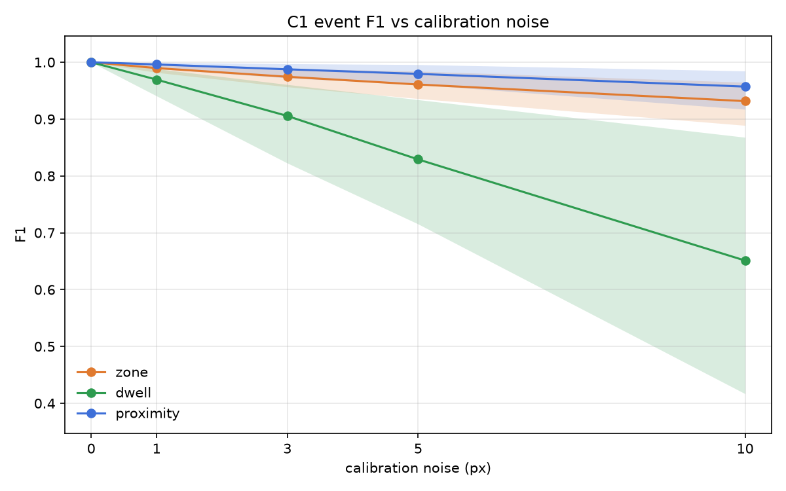

# Calibration-Aware Safety Events

**How much does a sloppy camera calibration change the safety alarms?**

Camera-based safety rules are written in meters ("stay 1.5 m apart", "don't enter this area"), but a camera only sees pixels. A planar homography *H*, estimated from four hand-picked image-to-floor correspondences, converts foot pixels to ground-plane positions. Deployed systems treat *H* as exact. This project measures how calibration error propagates to **event-level** precision, recall, and F1 for three event types: zone entry, dwell, and proximity.

Course project for PRCV (CS 5330), Northeastern University.
Dhanya Kini Bailoor and Tejaswini Sarikonda.

---

## Status

The full pipeline is built and verified on WILDTRACK camera **C1** with ground-truth tracks. The first calibration sweep (5 noise levels × 200 trials) is complete.

```
video → detection → tracking → foot point → homography → event logic → scoring
                                             └──────────── built and verified ────────────┘
```

Detection and tracking (off-the-shelf models) come next. Until then, experiments use the dataset's true positions, which isolates calibration error.

## Headline results (C1, ground-truth tracks, wide 4-point layout)

| ε (px) | Zone F1 | Dwell F1 | Proximity F1 | Mean position error |
|---:|---:|---:|---:|---:|
| 0 | 1.000 | 1.000 | 1.000 | 0.000 m |
| 1 | 0.990 (0.982–0.996) | 0.969 (0.941–0.988) | 0.996 (0.989–1.000) | 0.042 m |
| 3 | 0.974 (0.957–0.989) | 0.905 (0.823–0.961) | 0.988 (0.972–0.997) | 0.127 m |
| 5 | 0.961 (0.936–0.984) | 0.829 (0.715–0.934) | 0.979 (0.961–0.996) | 0.212 m |
| 10 | 0.932 (0.889–0.965) | 0.651 (0.417–0.868) | 0.957 (0.917–0.985) | 0.427 m |

Mean over 200 trials; brackets show the 5th–95th percentile.



**Findings so far**

1. **Proximity is the most robust event, not the most fragile.** Homography error is spatially smooth, so two nearby people are shifted almost identically and their distance barely changes.
2. **Dwell is by far the most fragile.** It stacks a spatial threshold and a time threshold; most visits last only 2–3 s, so a one-frame shift can erase the alarm.
3. **Distance from the camera dominates position error.** At 10 px: Near 0.22 m, Medium 0.45 m, Far 0.63 m. The Near zone has the smallest error even though it lies outside the calibration rectangle.
4. **Position error alone does not predict zone F1.** Medium degrades most (0.914 at 10 px). *Hypothesis, not yet tested:* more people walk close to its edge.
5. **Errors are symmetric.** Precision and recall fall by similar amounts, and alarm start times stay unbiased (within ±0.03 s).

**Calibration-tolerance guideline (F1 ≥ 0.95)**

| Event | On average | Worst 5% of trials |
|---|---|---|
| Proximity | ≥ 10 px | 5 px |
| Zone | 5 px | 3 px |
| Dwell | 1 px | < 1 px |

The full write-up, with every check and design choice, is in the [progress report](https://claude.ai/artifact/7udVqjRQZ2ekKrXTQ6sqwu).

---

## Dataset

[WILDTRACK](https://www.epfl.ch/labs/cvlab/data/data-wildtrack/) (Chavdarova et al., CVPR 2018): 7 synchronized, calibrated cameras, 1920 × 1080, 400 annotated frames at 2 fps (about 200 s), 313 people. Ground positions lie on a 480 × 1440 grid with 2.5 cm cells and origin (−3.0 m, −9.0 m). We use **one camera at a time**; the calibration provides the true homography *H\**.

### Download

Only the frames-and-annotations zip is needed (about 6.3 GB). The raw videos are not needed yet.

```bash
mkdir -p data && cd data
curl -L -C - -o Wildtrack_dataset_full.zip \
  "http://documents.epfl.ch/groups/c/cv/cvlab-unit/www/data/Wildtrack/Wildtrack_dataset_full.zip"
# If the download stops, run the same command again; -C - resumes it.
ditto -x -k Wildtrack_dataset_full.zip .   # macOS; the original zip can fail with other unzip tools
cd ..
```

The code expects the dataset at `data/Wildtrack_dataset` (set in one config variable, `DATA_ROOT`).

### Conventions (verified)

| Item | Convention |
|---|---|
| World coordinates | Meters everywhere in our code |
| Calibration `tvec` | Centimeters in the XML; divided by 100 on load |
| Intrinsics | `intrinsic_zero` (images are already undistorted) |
| Rotation | `rvec` converted with `cv2.Rodrigues` |
| Camera mapping | C1–C4 = CVLab1–4, C5–C7 = IDIAP1–3 (checked visually on all 7) |
| View index | `viewNum` is 0-based, so C1 = 0; a box of −1 means not visible |
| Time | Annotation file numbers step by 5; consecutive annotated frames are 0.5 s apart |

---

## Setup

```bash
python3 -m venv .venv
source .venv/bin/activate
pip install -r requirements.txt
```

Requires Python 3 with numpy, opencv-python, pandas, matplotlib, pyyaml, tqdm, and pytest.

## Repository layout

```
configs/events.yaml   zones, thresholds, hysteresis, debounce, dwell time
src/
  data.py             annotation loading, position ID → meters
  geometry.py         calibration, H* = K [r1 r2 t], projection, normalized DLT
  events.py           shared hysteresis function; zone, dwell, proximity detection
  evaluation.py       event matching and precision / recall / F1
  perturb.py          calibration points, pixel perturbation, single trial
  viz.py              plots and overlays
scripts/              runnable checks and experiments (below)
tests/                pytest suite
data/                 dataset (gitignored)
outputs/              results and plots (gitignored)
docs/figures/         selected plots committed for this README
```

## Running the pipeline

Run from the repository root.

```bash
# 1. Checks: dataset, calibration, geometry on all 7 cameras
python scripts/inspect_dataset.py
python scripts/check_annotations.py
python scripts/check_calibration.py
python scripts/check_homography.py      # overlays → outputs/check_homography_C{1..7}.png

# 2. Zones and the answer key (ground-truth events)
python scripts/show_zones.py
python scripts/make_gt_events.py        # → outputs/gt_events_C1.csv (+ no-hysteresis version)
python scripts/check_scoring.py         # answer key vs itself: every F1 must be 1.0

# 3. End-to-end sanity check: 0 px noise must give F1 = 1.0 on every seed
python scripts/check_zero_noise.py

# 4. The calibration sweep (5 noise levels × 200 trials, multiprocessing)
python scripts/run_sweep.py             # → outputs/sweep_C1_gt_tracks.csv and plots

# Tests
python -m pytest
```

## Method

**Events.** Each event becomes one number per frame, the *margin*: signed distance inside the zone (zone), or `threshold − distance` between two people (proximity). One shared state machine turns margins into intervals:

- on when the margin ≥ +h for `debounce_frames` consecutive frames
- off when the margin ≤ −h for `debounce_frames` consecutive frames
- a track may be missing for up to `max_gap_frames` without ending an open event

Dwell fires when a zone visit lasts at least `dwell_seconds`; the alarm starts at entry + `dwell_seconds`.

| Parameter | Value |
|---|---|
| Zones | 3 m × 3 m squares: Near (6.0, 0.0), Medium (7.0, 12.0), Far (4.0, 20.0), at 6.6, 18.0 and 26.3 m from the camera |
| Zone hysteresis | 0.1 m |
| Proximity threshold / hysteresis | 1.5 m / 0.1 m |
| Dwell time | 2.0 s (lowered from 3.0 s: 129 events instead of 32) |
| Debounce | 2 frames |
| Max gap | 1 frame |

**Answer key (C1).** 222 zone, 129 dwell, and 350 proximity events. Without hysteresis, the same perfect positions give 277, 133, and 562, so 25% of zone and 61% of proximity alarms would be flicker.

**Perturbation experiment.** The four calibration points form a 10.5 m × 24 m rectangle ("wide" layout); the Near zone lies outside it. For each trial, each of the four calibration pixels is moved by exactly ε ∈ {0, 1, 3, 5, 10} px in a uniformly random direction. *H* is re-estimated with our own normalized DLT (Hartley–Zisserman, verified against OpenCV), every true foot pixel is re-projected, and events are re-detected and scored. Each level uses seeds 0–199.

**Matching.** Events match when they share a type and identity (zone + person, or person pair) and overlap in time. Matching is one-to-one, greedy by temporal IoU.

## Verification

| Check | Result |
|---|---|
| Annotations vs the paper | 400 frames, 313 people, 30.41 frames/person |
| *H\** for C1 | Camera height 2.889 m; round trip ≈ 1e-13 m |
| Geometry tests, all 7 cameras | Round trip < 1e-6 m; matches `cv2.projectPoints` within 0.01 px |
| Hysteresis jitter test | ±5 cm jitter: 0 events with hysteresis, 20 without |
| Scoring self-check | F1 = 1.0 on every row, including one-frame events |
| Own DLT, 0 px | Recovers *H\** to ≈ 1.7e-9 |
| Full pipeline, 0 px | F1 = 1.0 on all seeds; largest foot shift 2.5e-14 m |

## Design choices to note

- **Duration** is `end − start`, so "dwell ≥ 2 s" means seen inside for at least 5 frames at 2 fps.
- **Matching is frame-inclusive:** an event covers `[start, end + 0.5 s)`, so one-frame events can match.
- **A missing frame resets a debounce run**, even within the allowed gap. With real detectors, single missed detections can delay or remove alarms.
- **Entering a zone** requires being 10 cm inside its edge.
- **Re-projected positions are rounded to 6 decimals** (1 µm) before detection. Positions, zone edges and the 0.1 m band all fall on the 2.5 cm grid, so floating-point noise could otherwise flip people sitting exactly on a threshold.
- **The proximity pre-filter** (2.1 m) uses the positions being evaluated, never the ground truth, so false alarms caused by a bad *H* stay visible. A test protects this.
- **Bounding-box bottoms are not exact ground positions**, even in the dataset (3.7–17.7 px mean offset per camera, more near the camera), because the boxes are projected cylinders.

## Limitations

- Only camera C1 and one calibration layout so far.
- Perfect positions; perception error is not yet included.
- Short clip (200 s), so the Near zone (33 zone, 17 dwell events) is noisier.
- 2 fps limits timing resolution to 0.5 s.
- Equal noise at all four points; minimal 4-point case only.

## Roadmap

- [ ] Threshold-distance analysis (test Finding 4) and dwell-failure breakdown
- [ ] Add ε = 2 px for a finer guideline
- [ ] Detector comparison (2–3 models) and tracker comparison (2–3 trackers), incl. ID switches
- [ ] Foot point: box bottom-center vs pose-model ankles
- [ ] Camera bump (small rotations) and calibration-layout experiments
- [ ] More than 4 points as a mitigation
- [ ] 2–3 more cameras with different viewing angles
- [ ] Error budget across pipeline stages

## References

1. R. Hartley and A. Zisserman. *Multiple View Geometry in Computer Vision*, 2nd ed. Cambridge University Press, 2003.
2. A. Criminisi, I. Reid, and A. Zisserman. A plane measuring device. *Image and Vision Computing*, 17(8):625–634, 1999.
3. N. S. Punn et al. Monitoring COVID-19 social distancing with person detection and tracking via fine-tuned YOLO v3 and Deepsort techniques. arXiv:2005.01385, 2020.
4. D. Yang et al. A vision-based social distancing and critical density detection system for COVID-19. *Sensors*, 21(13):4608, 2021.
5. T. Chavdarova et al. WILDTRACK: A multi-camera HD dataset for dense unscripted pedestrian detection. *CVPR*, 2018.